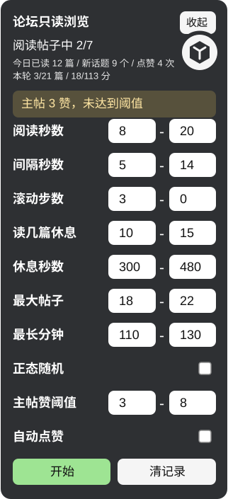

# Forum Read-Only Browse Helper（论坛只读浏览助手）

一个面向 Discourse 类论坛的只读浏览用户脚本，是 [baiya123/linuxdo-read-plugin](https://github.com/baiya123/linuxdo-read-plugin) 的增强 fork。

脚本会在白名单论坛页面的右下角显示一个手动控制面板，用于按可配置的停留时间阅读最新帖子、滚动页面并返回列表继续浏览。生效范围由脚本头部的 `@match` 域名白名单和脚本内置的 `DOMAIN_WHITELIST` 双重限制，不会在未授权站点运行。

## 支持的论坛（域名白名单）

- `linux.do`
- `nodeloc.com`
- `meta.discourse.org`
- `discuss.python.org`
- `forum.vuejs.org`
- `forum.arduino.cc`

添加其他同类论坛：在脚本头部加一行 `// @match https://域名/*`，同时在脚本内 `DOMAIN_WHITELIST` 数组中加入相同域名即可。要求目标论坛为 Discourse 架构（帖子路径形如 `/t/…`）。

## 功能

- 在白名单论坛页面显示“论坛只读浏览”控制面板
- 手动开始或停止自动只读浏览
- 自动从最新列表选择未读帖子
- 从列表中模拟点击话题进入同一标签页
- 在帖子页随机停留、分段滚动；滚动最大步数设为 `0` 时会一直读到底才算完成
- 读完后优先使用浏览器历史返回列表，再继续查找下一篇帖子
- 记录最近浏览过的帖子，减少重复打开
- 可清空本地浏览记录
- 可显示今日已读帖子数量，并按本地日期自动归零
- 可显示今日新话题数量，用于判断是否持续进入新的 topic
- 可显示今日自动点赞数量，并按本地日期自动归零
- 可配置阅读秒数、间隔秒数和每篇帖子的滚动步数
- 随机时长支持两种分布：默认均匀分布；勾选“正态随机”后按截断正态分布取值（均值在区间中点，约 99.7% 的取样落在区间内），行为节奏更接近真人
- 可设置阅读指定篇数范围后自动休息一段时间（每轮在范围内随机取样）
- 可设置休息秒数范围（每次休息在范围内随机取样）
- 可设置本轮任务最多阅读多少篇帖子的范围，每轮开始时在范围内随机取样上限；填 `0` 表示不限制
- 可设置本轮任务最长运行分钟数范围，每轮开始时在范围内随机取样上限；填 `0` 表示不限制
- 可收起悬浮控制面板，并在刷新后保持收起状态
- 收起后的圆形浮标可拖动，松手后自动吸附到左/右边缘并半隐藏进屏幕；悬停浮标滑出，展开的面板跟随浮标位置显示，位置刷新后保持
- 可设置主帖点赞数阈值范围，每篇帖子在范围内随机取样阈值，达到时提示并高亮原生点赞控件
- 可开启辅助自动点赞：脚本运行中且主帖点赞数达到阈值时，自动点击主帖点赞按钮（默认关闭）
- 兼容没有反应计数块、但在主帖统计区显示点赞数的帖子
- 简易 CF 盾/人机验证检测：仅在页面完全加载完成后判定（正常加载过程不误报），检测到 Cloudflare 全屏挑战页或人机验证时暂停全部自动化，等待人工通过验证后刷新继续，等待期间不点击、不刷新、不导航

## 界面预览



## 安装

1. 安装用户脚本管理器，例如 Tampermonkey、Violentmonkey 或 Greasemonkey。
2. 打开 GitHub Raw 安装地址：[linuxdo-read-only-browse.user.js](https://raw.githubusercontent.com/huangsijun17/linuxdo-read-plugin/main/linuxdo-read-only-browse.user.js)。
3. 用户脚本管理器弹出安装页后点击安装。
4. 后续脚本管理器会通过脚本头部的 `@downloadURL` 和 `@updateURL` 从 GitHub Raw 检查更新。
5. 打开任一白名单论坛的列表页（例如 `https://linux.do/latest`），页面右下角会出现控制面板。

> 从上游 0.4.6 及更早版本升级无需清理数据：旧的“读几篇休息”“休息秒数”单值设置会自动迁移为等值范围。

## 使用

1. 打开白名单论坛的任意页面。
2. 在右下角面板中设置阅读秒数、间隔秒数、滚动步数、休息规则和本轮停止条件；如需更拟人的节奏可勾选“正态随机”。
3. 点击“开始”，脚本会先前往当前站点的最新列表。
4. 脚本会自动前往最新列表，点击话题进入同一标签页，只读停留并滚动，然后使用浏览器历史返回列表继续。
5. 需要停止时点击“停止”。

## 面板说明

| 控件 | 说明 |
| --- | --- |
| 阅读秒数 | 每篇帖子停留和滚动阅读的随机时间范围 |
| 今日已读 | 今日完成阅读的帖子数量，按本地日期自动归零 |
| 新话题 | 今日首次进入的唯一话题数量，按本地日期自动归零 |
| 今日点赞 | 今日由辅助自动点赞功能完成的点赞数量，按本地日期自动归零 |
| 间隔秒数 | 打开帖子、返回列表等动作之间的随机等待时间范围 |
| 滚动步数 | 每篇帖子基础滚动步数；最大值设为 `0` 时表示一直下拉到右侧时间轴进度读到最后，或看到明确的话题底部控件才算完成 |
| 读几篇休息 | 完整读完多少篇帖子后进入长休息；支持范围，每轮启动或每次休息结束后在范围内随机取样 |
| 休息秒数 | 达到阅读篇数后暂停多久再继续；支持范围，每次休息随机取样 |
| 最大帖子 | 本轮任务最多完整读完多少篇帖子后自动停止；每轮开始时在范围内随机取样，两个都填 `0` 表示不限制 |
| 最长分钟 | 本轮任务运行多少分钟后自动停止；每轮开始时在范围内随机取样，两个都填 `0` 表示不限制 |
| 正态随机 | 勾选后所有随机时长/步数按截断正态分布取值（中心为区间中点）；不勾选为均匀分布 |
| 主帖赞阈值 | 每篇帖子在范围内随机取样点赞阈值，主帖点赞数达到取样值时提示并高亮点赞控件；两个都填 `0` 表示关闭提示和自动点赞 |
| 自动点赞 | 开启后，仅在脚本运行中且主帖点赞数达到阈值时，自动点击主帖点赞按钮 |
| 收起/展开 | 隐藏面板内容或恢复显示，收起时显示圆形浮标；浮标可拖动并吸附左/右边缘（半隐藏，悬停滑出），展开后的面板跟随浮标位置 |
| 开始/停止 | 启用或暂停只读浏览 |
| 清记录 | 清空本地已浏览帖子记录 |

## 注意事项

- 本脚本只保存少量配置和浏览记录到用户脚本管理器的本地存储中。
- 自动点赞默认关闭（默认不点赞）：需要同时把“主帖赞阈值”设为大于 `0` 并勾选“自动点赞”才会生效；开启后只会对当前主帖执行点赞，不会评论、收藏、关注或私信。
- 遇到 CF 盾或人机验证时，面板状态会显示“检测到 CF 盾/人机验证，已暂停自动化，请手动完成验证”，此时请手动完成验证，脚本会在验证通过后自动刷新继续，不会尝试绕过验证。
- `滚动步数` 最大值设为 `0` 时，会优先读取右侧时间轴的“当前楼 / 总楼数”，只有读到最后或看到明确的话题底部控件后才会计入“今日已读”；否则按设置的最大步数完成后计入。
- `最大帖子` 和 `最长分钟` 只限制当前这一轮任务；每次点击“开始”都会重新取样本轮上限并重新计算已读数量和运行时间。两个都填 `0` 表示该组不限制；只填一侧时另一侧按 `1` 处理，不会出现“随机到 0”的情况。
- 请合理设置浏览频率，避免过短间隔造成异常访问；部分论坛对自动化浏览有明确的社区规则，使用前请自行确认。
- 页面结构如果发生较大变化，帖子链接识别可能需要调整。

## 开发

当前项目只有一个用户脚本文件：

```text
linuxdo-read-only-browse.user.js
```

修改后运行语法检查：

```powershell
node --check .\linuxdo-read-only-browse.user.js
```

再在用户脚本管理器中重新保存脚本，刷新白名单论坛页面进行验证。

## 许可证

未指定许可证。使用、分发或修改前请先确认仓库所有者意图。
